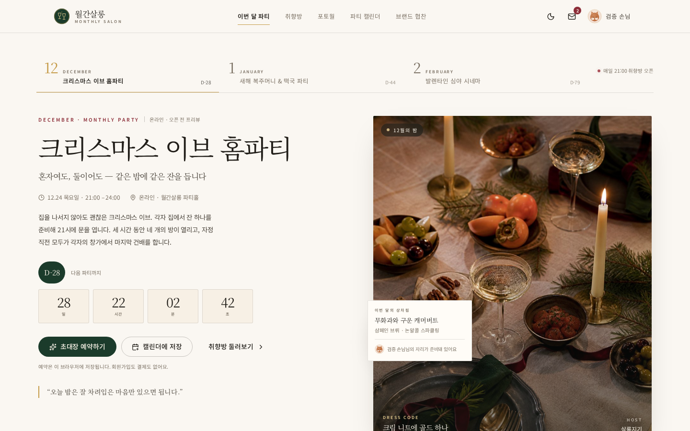
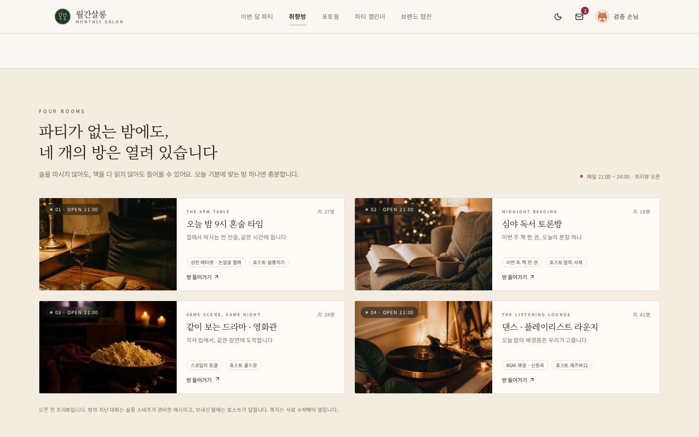
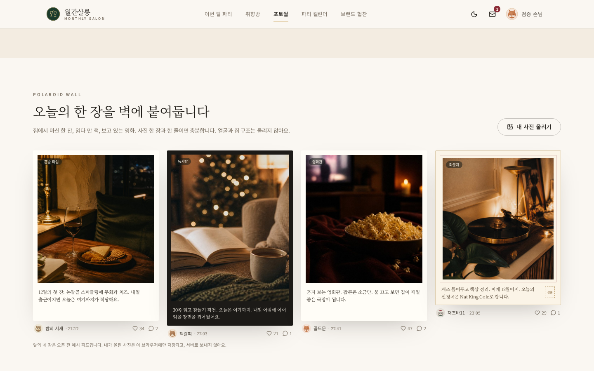
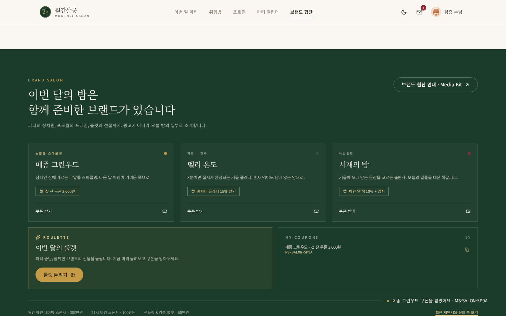
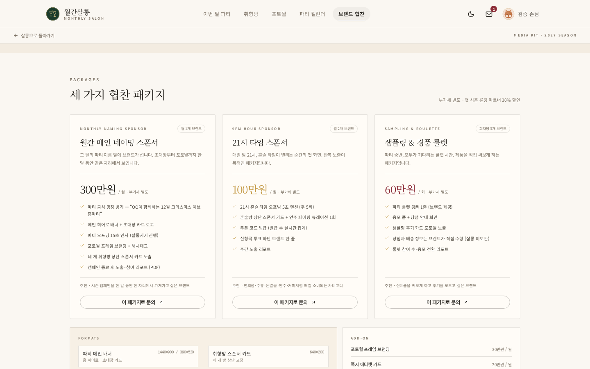
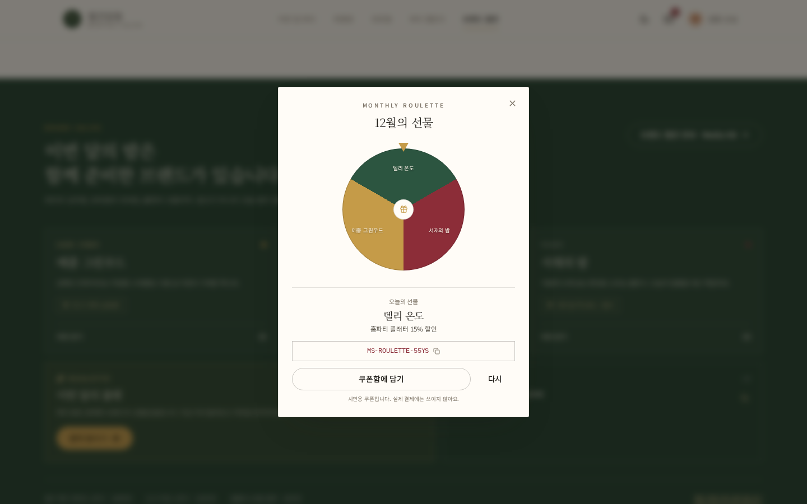
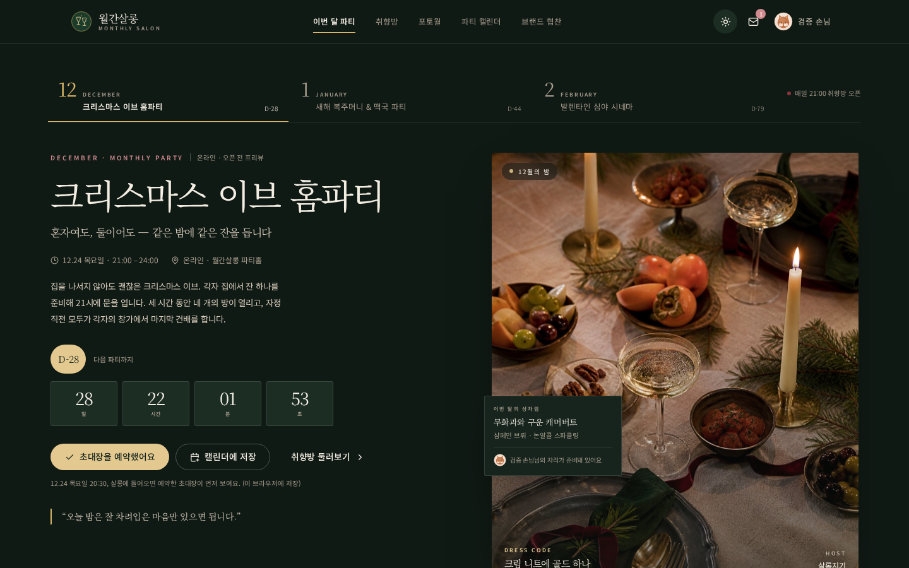

# 딩동 · DINGDONG

> 매월의 큰 파티와 매일 밤의 작은 취향방.
> 같은 밤을 보내는 사람들끼리의 온라인 살롱.

12월 크리스마스 이브 홈파티를 시작으로, 1월 복주머니·떡국 파티, 2월 발렌타인 심야 시네마까지. 매월 한 번의 큰 파티가 열리고, 그 사이의 평일 밤에는 네 개의 취향방이 21시에 문을 엽니다. 회원가입 없이 캐릭터와 닉네임만으로 입장하며, 쪽지는 서로 수락해야 열립니다.



## 이 서비스가 하는 일

| 영역 | 구현 |
| --- | --- |
| 월간 빅 파티 | 12월·1월·2월 테마 전환, 실시간 D-day 카운트다운, 초대장 예약(브라우저 저장), `.ics` 캘린더 내려받기, 파티 프로그램·상차림·호스트·드레스 코드 |
| 파티 캘린더 | 2026년 12월 ~ 2027년 2월 미니 달력, 설날(2.6) 추가 회차, 회차별 알림 신청 |
| 네 개의 취향방 | ① 21시 혼술 타임 ② 심야 독서 토론 ③ 같이 보는 영화관 ④ 플레이리스트 라운지 |
| 방 안의 대화 | 방별 채팅 기록 유지, 호스트(AI) 응답, 스포일러 토글, 한 줄 평, 신청곡 투표와 실제 재생 |
| 소리 | Web Audio API로 합성한 유리잔 '짠', 박수, 종소리 + 로우파이·재즈·파티 비트 BGM (외부 음원 없음) |
| 캐릭터 입장 | 8종 SVG 캐릭터, 닉네임, 선택형 연령대·관심사 태그, 프로필 삭제 |
| 포토월 | 내 사진 업로드(자동 축소) → 폴라로이드/매거진/엽서 프레임 → 게시, 좋아요·댓글, 내 글 삭제 |
| 건전한 인연 | 방에서 쪽지 청하기 → 상대 수락 → 1:1 쪽지, 거절·신고, 에티켓 안내 |
| 브랜드 협찬 | 파티 스폰서 존, 쿠폰 코드 발급, 경품 룰렛, 미디어킷(패키지 3종·광고 상품·프로세스·문의 폼) |
| 나이트 모드 | 크림/포레스트/버건디/골드 팔레트의 다크 파티 모드 |

### 화면

| 취향방 | 포토월 | 브랜드 협찬 |
| --- | --- | --- |
|  |  |  |

| 미디어킷 패키지 | 룰렛 | 나이트 모드 |
| --- | --- | --- |
|  |  |  |

모바일(390×844) 화면은 `docs/screenshots/20-mobile-*.png` ~ `28-mobile-*.png`에 있습니다.

## 실행

```bash
# 이 작업 환경에서는 Node가 PATH에 없을 수 있습니다.
export PATH=/workspace/.tools/node-v22.12.0-linux-x64/bin:$PATH

npm install
npm run dev          # 개발 서버
npm run build        # 타입체크 + 프로덕션 빌드
npm run typecheck    # tsc --noEmit
npm run typecheck:api # 서버리스 함수 타입체크
npm run verify       # Playwright 자동 검증 (아래 참고)
```

API까지 로컬에서 확인하려면:

```bash
node_modules/.bin/esbuild api/party-chat.ts --bundle --format=esm --platform=node --target=node20 --outfile=.tmp/party-chat.mjs
PORT=4210 node scripts/serve.mjs
```

`scripts/serve.mjs`는 `dist/`를 서빙하고 `/api/party-chat`을 실제 핸들러로 넘깁니다. `GEMINI_API_KEY`가 없으면 핸들러의 폴백 응답이 그대로 동작합니다.

## 구조

```
api/
  party-chat.ts        Vercel Serverless Function · 방/쪽지용 호스트 응답 (Gemini + 폴백)
src/
  data/                파티 3회차, 취향방·참여자·신청곡, 예시 포토월, 미디어킷 상품
  lib/
    audio.ts           Web Audio 합성 (짠·박수·종, 3가지 BGM 무드)
    chat.ts            /api/party-chat 호출 + 브라우저 폴백
    storage.ts         localStorage 영속 상태 훅
    dates.ts           카운트다운, .ics 생성
    image.ts           업로드 사진 축소
    coupons.ts         쿠폰·문의 접수번호 생성
  components/          Header, Hero, Program, Rooms, RoomOverlay, PhotoWall,
                       Sponsors/Roulette, Calendar, MediaKit, Notes, Onboarding …
  App.tsx              화면 조립과 상태(프로필·예약·알림·피드·쪽지·쿠폰)
scripts/
  serve.mjs            검증용 정적+API 서버
  verify.py            Playwright 검증 (데스크톱·모바일)
docs/screenshots/      검증 중 저장한 화면
```

## API

`POST /api/party-chat`

```jsonc
{
  "mode": "room",                  // "room" | "note"
  "roomId": "wine",                // wine | book | cinema | music
  "roomName": "오늘 밤 9시 혼술 타임",
  "roomTopic": "집에서 마시는 한 잔을, 같은 시간에 듭니다",
  "topicDetail": "오늘의 질문: …",
  "host": "살롱지기",
  "profile": { "nickname": "손님", "ageBand": "30대", "tags": ["독서"] },
  "peer": null,                    // mode=note일 때 { nickname, ageBand, tags, context }
  "message": "오늘 야근했어요",
  "history": [{ "role": "me", "name": "손님", "text": "…" }]
}
```

응답: `{ "reply": "…", "model": "gemini-2.5-flash-lite" }` (키가 없거나 호출 실패 시 `"model": "local"`)

- 모델: `GEMINI_MODEL`이 있으면 그 모델을 먼저 시도하고, `gemini-2.5-flash-lite` → `gemini-2.0-flash` → `gemini-3.5-flash-lite` 순으로 재시도합니다.
- 프롬프트에는 방 규칙(과음 금지·논알콜 동일 대접·스포일러 표시), 프로필, 최근 대화가 포함됩니다.
- 키가 없을 때는 방별 키워드에 반응하는 호스트 폴백이 답합니다. 그래서 시연 환경에서도 대화가 끊기지 않습니다.
- 쪽지 모드에서는 연락처·SNS·주소를 먼저 묻거나 알려주지 않도록 지시합니다.

## 검증

```bash
export PATH=/workspace/.tools/node-v22.12.0-linux-x64/bin:$PATH
export LD_LIBRARY_PATH=/workspace/.libs/usr/lib/x86_64-linux-gnu:$LD_LIBRARY_PATH
npm run build
python3 scripts/verify.py
```

최근 결과: **63/63 통과**.

- API: 채팅 응답·모델 표기·빈 메시지 거절·쪽지 모드
- 데스크톱 1440×900: 온보딩 → 12/1/2월 전환 → 초대장·`.ics` → 프로그램 → 취향방 4개 → 혼술방 채팅·호스트 응답·건배 카운터 → 라운지 BGM·신청곡 투표 → 영화방 스포일러 → 독서방 한 줄 평 → 포토월 업로드·좋아요 → 쪽지 수락·대화 → 스폰서 쿠폰·룰렛 → 미디어킷 패키지·문의 폼 → 나이트 모드 → 새로고침 후 유지
- 모바일 390×844: 온보딩 → 홈 → 취향방 → 방 채팅·응답 → 쪽지함 → 미디어킷, 가로 넘침 없음
- 콘솔 오류 0

## 배포

- Vercel: 루트 디렉터리를 이 폴더로 두고 배포하면 `vercel.json`의 `buildCommand`/`outputDirectory`/`functions` 설정으로 동작합니다.
- 환경 변수: `GEMINI_API_KEY`(선택), `GEMINI_MODEL`(선택).
- 키가 없어도 사이트는 완전히 동작합니다(폴백 응답).

## 프라이버시와 에티켓

- 회원가입·실명·연락처를 받지 않습니다. 프로필, 초대장, 알림, 포토월, 쪽지, 쿠폰은 **이 브라우저(localStorage)**에만 저장되고 서버로 보내지 않습니다. 업로드 사진도 브라우저에서 축소·보관합니다.
- 쪽지는 방에서 대화한 뒤 청하고, 상대가 수락해야 열립니다. 거절은 상대에게 알리지 않습니다. 신고는 사유와 함께 저장되어 운영 검토에 쓰입니다.
- 과음·술 권유·미성년자 음주를 금지하고, 논알콜도 같은 잔으로 대접합니다. 얼굴·집 구조 사진, 연락처·계좌 요구는 규칙 위반입니다.
- 코드·화면에 실제 인물의 실명, 회사, 연락처, API 키가 없습니다.

## 협찬 상품 (미디어킷)

| 패키지 | 가격 | 정원 | 핵심 |
| --- | --- | --- | --- |
| 월간 메인 네이밍 스폰서 | 300만원/월 | 1 | 파티 명칭 병기, 히어로·초대장·오프닝 인사·포토월 프레임·리포트 |
| 21시 타임 스폰서 | 100만원/월 | 2 | 매일 21시 오프닝 멘션, 방 상단 카드, 쿠폰 발급 |
| 샘플링 & 경품 룰렛 | 60만원/회 | 3 | 경품 룰렛, 응모·당첨 안내, 후기 카드, 참여 리포트 |

부가세 별도, 첫 시즌 론칭 파트너 30% 할인. 문의는 `partners@monthlysalon.kr`로 받도록 되어 있습니다.

## 오픈 전 프리뷰에 대해

이 저장소는 서비스 오픈 전 시연 버전입니다.

- 취향방의 지난 대화와 포토월 앞 네 장, 받은 쪽지 요청 2건은 **살롱 스태프가 준비한 예시**입니다. 화면 안에서도 그렇게 안내합니다.
- 스폰서 브랜드(메종 그린우드, 델리 온도, 서재의 밤 등)는 **가상의 예시**이며 실제 협찬 계약과 무관합니다.
- 미디어킷의 참여자·재방문·체류 수치는 **2027 상반기 목표 지표**로 표기했습니다. 실제 수치가 아닙니다.
- 문의 폼은 서버로 전송하지 않고, 접수번호가 붙은 문의서를 만들어 복사하거나 메일 앱으로 열어주는 방식입니다. `partners@monthlysalon.kr`은 실제 도메인·메일함으로 교체해야 합니다.

## 다음 단계 (실서비스에 필요한 것)

1. 계정·실시간 동기화: 현재 대화·참여자는 브라우저/시뮬레이션이므로, 공개 오픈에는 인증·DB(예: Supabase)·WebSocket/SSE가 필요합니다.
2. 알림: 브라우저 저장 대신 이메일·푸시 발송(초대장, 21시 오픈, 룰렛 당첨).
3. 신고·차단 운영 도구와 운영자 콘솔.
4. 협찬 정산·쿠폰 실제 발급 연동, 개인정보 처리방침·이용약관.
5. 실제 도메인과 문의 메일함, 스폰서 소재 검수 가이드.
